# Mojave Sphinx stand — 3D safety summary

params: `params.yaml` · 24 solves + 7 sweep · targets: member SF ≥ 2, joint SF ≥ 2 (DF = 2 already in the loads)

**Parameters changed from defaults**

- `base.mode`: line → **ground**  (--set)

> ground mode: 195 contact springs on 11 base members, no 3-2-1 restraint

## Headline

| quantity | value | governing |
|---|---|---|
| lowest joint SF | **0.10** (N8 triangle leg b on M22, U_Mz) | R-bOFF/-y |
| lowest member SF | **1.69** (M32 yield) | k=1-bOFF/-y |
| frame buckling λ | **10.67** (pass vs 2) | k=1-bOFF/-y |
| thrust-point deflection | 25.79 mm (x -4.14, y -25.00, z +4.76) | k=1-bOFF/-y |
| thrust-point tilt | 1.339° **> 0.25° flag** | k=1-bOFF/-y |
| sandbags (FS 1.5 on tipping and lift) | **4 × 100 kg = 400 kg** | tipping over footprint edge 2 (1025,135)->(315,135) mm, case +y |
| sandbag mass (net uplift / g, FS 1) | **196.4 kg** (1926 N) | all cases |

## Ground contact

Base on 195 compression-only contact springs (k_s = 150 MN/m³, compacted gravel; 25.4 mm wide; horizontal = 0.5 × vertical). No assumed base load: the ground pushes up only where the base presses down.

**Sandbags** (rigid-body statics, equal mass per station, rounded up to 5 kg):

| station | where | mass |
|---|---|---|
| M19 @ 225 mm, 300 mm long | x 1270, y -20 mm | 100 kg |
| M25 @ 225 mm, 300 mm long | x 1270, y -310 mm | 100 kg |
| M22 @ 522 mm, 155 mm long | x 1025, y 57 mm | 100 kg |
| M22 @ 78 mm, 155 mm long | x 1025, y -388 mm | 100 kg |

Sized by tipping over footprint edge 2 (1025,135)->(315,135) mm, case +y (needs 98.6 kg each before rounding).

| case | FS tipping | FS lift | contact | peak q kN/m | sliding FS (μ 0.5) | lowest base-joint SF |
|---|---|---|---|---|---|---|
| none | 1.67 | 1.90 | 77 % | 3.3 | ∞ | 0.15 |
| +x | 1.78 | 1.90 | 80 % | 3.4 | 15.0 | 0.15 |
| -x | 1.58 | 1.90 | 73 % | 3.1 | 15.0 | 0.15 |
| +y | 1.52 | 1.90 | 69 % | 4.0 | 15.0 | 0.10 |
| -y | 1.52 | 1.90 | 69 % | 4.0 | 15.0 | 0.10 |
| +x+y | 1.52 | 1.90 | 64 % | 4.0 | 10.6 | 0.10 |

**Sensitivity to ground stiffness** (run R, all cases):

| k_s MN/m³ | lowest base-joint SF | lowest joint SF | peak q kN/m | least contact |
|---|---|---|---|---|
| 50 | 0.09 | 0.09 | 2.8 | 73 % |
| 150 | 0.10 | 0.10 | 4.0 | 64 % |
| 500 | 0.10 | 0.10 | 6.9 | 43 % |

Displacements are relative to the best-fit rigid motion of the base nodes (i.e. to the ground).

**In this folder:** [figures](#figures) (below, and in `figures/`) · `viewer.html` (interactive 3D, click any bracket for its free-body diagram; download and open locally) · `tables/members.csv`, `tables/joints.csv`, `tables/ktheta_sweep.csv` · `params_used.yaml` (exact inputs of this run)

## Lowest 10 joint SFs

SF = 1/U with U = Σ term demand/capacity (linear interaction). *Share* = that term's part of U; *SF if alone* = the SF if only that term acted.

| SF | joint | bracket | type | leg | on | governs | share | SF if alone | run/case |
|---|---|---|---|---|---|---|---|---|---|
| 0.10 | N8 | 1 | triangle | b | M22 | twist Mz | 89 % | 0.11 | R-bOFF/-y |
| 0.10 | N7 | 1 | triangle | a | M22 | twist Mz | 89 % | 0.11 | R-bOFF/+y |
| 0.14 | N9 | 0 | triangle | b | M1 | twist Mz | 73 % | 0.20 | R-bOFF/+x+y |
| 0.15 | N10 | 0 | triangle | a | M21 | twist Mz | 75 % | 0.19 | R-bOFF/-y |
| 0.23 | N28 | 3 | triangle | a | M7 | twist Mz | 71 % | 0.32 | R-bON/-y |
| 0.23 | N27 | 3 | triangle | a | M9 | twist Mz | 71 % | 0.33 | R-bON/+y |
| 0.24 | N28 | 3 | triangle | b | M32 | twist Mz | 67 % | 0.35 | R-bON/-y |
| 0.24 | N27 | 3 | triangle | b | M18 | twist Mz | 67 % | 0.36 | R-bON/+y |
| 0.25 | N8 | 1 | triangle | a | M19 | twist Mz | 74 % | 0.34 | k=1-bOFF/-y |
| 0.25 | N7 | 0 | triangle | b | M34 | twist Mz | 94 % | 0.27 | R-bOFF/-x |

## Lowest 10 member SFs

| SF | member | profile | governs | σ (MPa) | N (N) | My (N·m) | Mz (N·m) | SF yield | SF buckle | SF beam-col | run/case |
|---|---|---|---|---|---|---|---|---|---|---|---|
| 1.69 | M32 | 1010 | yield | 102.0 | 455 | -16.3 | -129.1 | 1.69 | 194588.64 | 77284.86 | k=1-bOFF/-y |
| 1.87 | M17 | 1010 | yield | 91.8 | 70 | -2.9 | -129.8 | 1.87 | 2536.28 | 2.06 | k=1-bOFF/-y |
| 1.98 | M18 | 1010 | yield | 87.0 | 414 | -0.5 | -123.4 | 1.98 | 194588.64 | 77284.86 | k=1-bOFF/-y |
| 2.86 | M19 | 1010 | yield | 60.1 | 14 | 6.1 | -80.9 | 2.86 | 6659.45 | 4.99 | k=1-bOFF/-y |
| 3.17 | M25 | 1010 | yield | 54.3 | 44 | 1.3 | -77.2 | 3.17 | 6670.25 | 4.99 | R-bOFF/+x+y |
| 3.30 | M9 | 1010 | beam-col | 47.6 | -451 | -11.9 | 54.8 | 3.61 | 24.84 | 3.30 | R-bON/+y |
| 3.30 | M7 | 1010 | beam-col | 47.6 | -451 | 11.9 | 54.8 | 3.61 | 24.87 | 3.30 | R-bON/-y |
| 3.74 | M22 | 1010 | yield | 46.0 | 21 | 1.1 | -65.4 | 3.74 | 6395.75 | 6.92 | R-bOFF/-y |
| 4.16 | M12 | 1010 | beam-col | 40.7 | -32 | -1.0 | 57.8 | 4.22 | 383.45 | 4.16 | k=1-bOFF/-y |
| 4.45 | M6 | 1010 | yield | 38.6 | 160 | -0.3 | 54.9 | 4.45 | 383.83 | 5.27 | R-bOFF/+y |

## Mechanism checks

- **Run P invalid** for cases none, +x, -x, +y, -y, +x+y: a node moves more than 1 mm → *mechanism — pinned result invalid; joints carry moment*. Run R used for those cases.
- P-bON: lowest K eigenvalue / max diag = 6.49e-13 **(mechanism)**; softest mode dominated by node 155 (M18 s=980 mm) uy, node 334 (M32 s=980 mm) uy, node 283 (M27 s=0 mm) uy
- P-bOFF: lowest K eigenvalue / max diag = 1.05e-13 **(mechanism)**; softest mode dominated by node 83 (M7 s=667 mm) rz, node 82 (M7 s=556 mm) rz, node 84 (M7 s=778 mm) rz
- R-bON: lowest K eigenvalue / max diag = 1.75e-10; softest mode dominated by node 99 (M9 s=667 mm) rz, node 151 (M18 s=705 mm) rz, node 330 (M32 s=705 mm) rz
- R-bOFF: lowest K eigenvalue / max diag = 1.89e-10; softest mode dominated by node 83 (M7 s=667 mm) rz, node 99 (M9 s=667 mm) rz, node 151 (M18 s=705 mm) rz

## k_θ sweep (-y, bearing OFF)

| k_θ / (EI/L) | max node δ (mm) | valid | λ | lowest SF |
|---|---|---|---|---|
| 0.001 | 1.54e+04 | no | 0.02 | 0.18 (N8#1.0:b) |
| 0.01 | 1.59e+03 | no | 0.23 | 0.17 (N8#1.0:b) |
| 0.1 | 172 | no | 1.95 | 0.16 (N8#1.0:b) |
| 1 | 26.4 | yes | 10.67 | 0.14 (N8#1.0:b) |
| 10 | 10.1 | yes | 26.75 | 0.11 (N8#1.0:b) |
| 100 | 8.09 | yes | 34.90 | 0.10 (N8#1.0:b) |
| 1000 | 7.85 | yes | 36.15 | 0.10 (N8#1.0:b) |

Items whose utilisation peaks at an interior k_θ (value used in the envelope):

- M20: U = 0.024 at k = 10 (ends 0.023 / 0.024)
- M27: U = 0.127 at k = 10 (ends 0.120 / 0.090)
- M33: U = 0.001 at k = 100 (ends 0.001 / 0.001)
- N1#1.0:a: U = 1.329 at k = 10 (ends 1.249 / 1.309)
- N10#0.0:b: U = 2.688 at k = 10 (ends 2.656 / 2.614)
- N11#0.0:a: U = 0.510 at k = 10 (ends 0.505 / 0.504)
- N12#0.0:a: U = 0.492 at k = 10 (ends 0.487 / 0.485)
- N13#1.0:b: U = 0.600 at k = 10 (ends 0.591 / 0.586)
- N14#1.0:a: U = 0.646 at k = 10 (ends 0.606 / 0.637)
- N14#1.0:b: U = 0.496 at k = 100 (ends 0.400 / 0.495)
- N19#0.0:a: U = 0.559 at k = 100 (ends 0.415 / 0.557)
- N2#0.0:a: U = 0.074 at k = 100 (ends 0.069 / 0.074)
- N2#0.0:b: U = 0.018 at k = 100 (ends 0.009 / 0.018)
- N2#1.0:a: U = 0.327 at k = 10 (ends 0.302 / 0.301)
- N23#0.0:a: U = 0.546 at k = 100 (ends 0.312 / 0.540)
- N23#0.0:b: U = 0.469 at k = 100 (ends 0.378 / 0.467)
- N27#0.0:b: U = 3.748 at k = 10 (ends 2.939 / 3.559)
- N28#0.0:b: U = 3.620 at k = 10 (ends 3.277 / 3.543)
- N30#0.0:b: U = 3.716 at k = 10 (ends 3.713 / 3.705)
- N30#2.0:a: U = 3.716 at k = 10 (ends 3.713 / 3.705)

## Joint capacities used

- friction per bolt μF_i = 1000 N, pull F_i = 5000 N, triangle tilt M = F_i·a = 63.5 N·m, twist μF_i·r_f = 4.63 N·m (r_f = 4.63 mm)
- T-plate sections (computed from the outline): A line b_net = 54.8 mm (brief 54.8); B line 49.2 mm (brief 36.5); B through lower hole 43.7 mm (brief 56.4); stem neck 76.2 mm (added check)

## Unverified inputs

| parameter | value | flag | meaning |
|---|---|---|---|
| `triangle.tilt_arm_mm` | 12.7 mm | placeholder | gap-opening arm a: Mx,max = My,max = F_i*a |
| `plate.thickness_mm` | 6.35 mm | placeholder | plate thickness t |
| `section_1010.J_mm4` | auto mm4 | unverified | torsion constant; auto = 0.5*(Iy+Iz) |
| `section_1020.J_mm4` | auto mm4 | unverified | torsion constant; auto = 0.5*(Iy+Iz) |
| `loads.misalign_x` | 0.03 - | assumption | horizontal x load as fraction of factored thrust |
| `loads.misalign_y` | 0.03 - | assumption | horizontal y load as fraction of factored thrust |
| `bolts.preload_N` | 5000 N | assumption | 1/4-20 bolt preload F_i |
| `bolts.mu` | 0.2 - | assumption | friction coefficient, one surface |
| `base.mode` | ground | assumption | line = brief: sandbag line load that exactly balances the stand | ground = base on compression-only gravel springs + discrete sandbags (3D only; `run --ground`) |
| `ground.k_s_MN_per_m3` | 150 MN/m3 | assumption | modulus of subgrade reaction, compacted gravel (typical 100-200) |
| `ground.kh_ratio` | 0.5 - | assumption | horizontal / vertical contact stiffness (friction, sticking) |
| `ground.mu` | 0.5 - | assumption | aluminium on gravel friction, for the sliding check |
| `sandbags.stations` | [[19, 225, 300], [25, 225, 300], [22, 522.5, 155], [22, 77.5, 155]] | assumption | bags: [member, centre along member mm, length mm]; default = thrust-end outriggers M19/M25 under the thrust line + both stubs of cross beam M22 |
| `sandbags.FS_tip` | 1.5 - | assumption | stabilising / overturning moment about every footprint edge (and lift) |
| plate_other brackets | — | no capacity | forces reported only |

## Figures

### Safety factor by member and joint (front / side / plan)

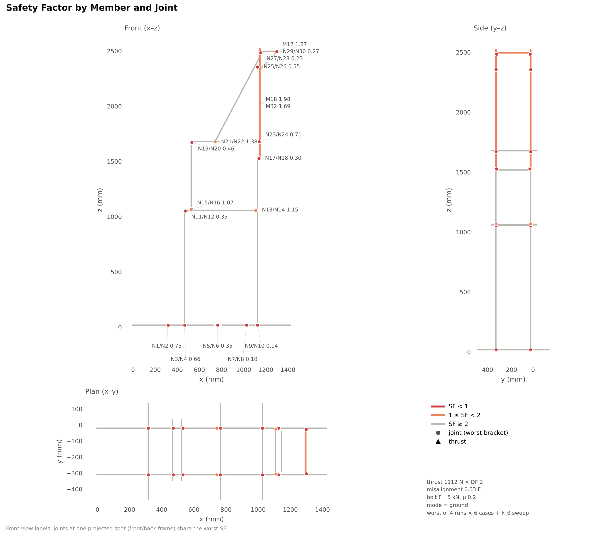

### Lowest safety factors

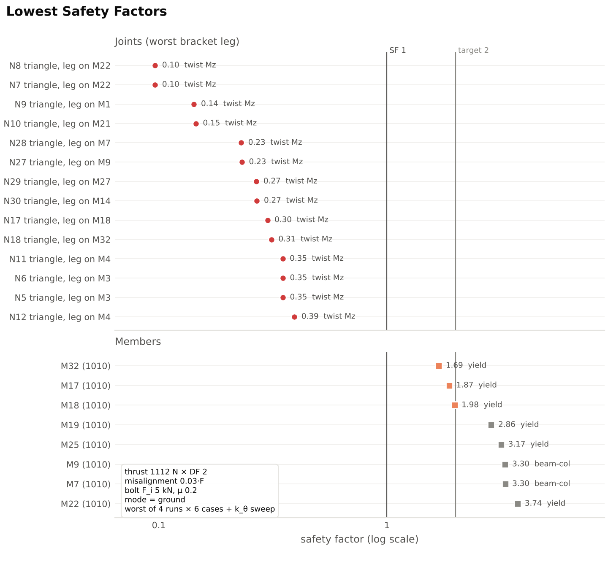

### Joint SF and the share of each failure term

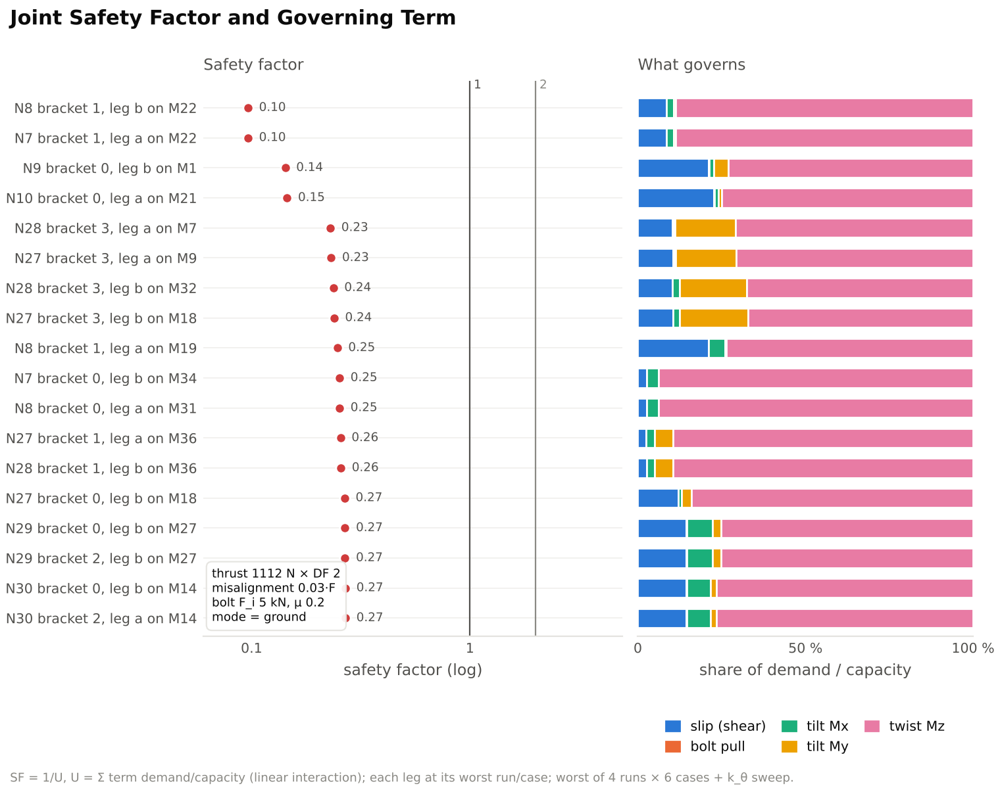

### SF of the critical items in every load case

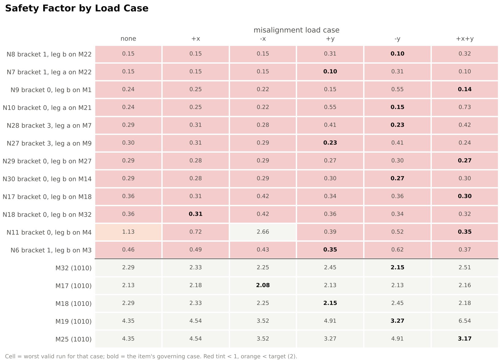

### Thrust-point tilt and deflection by load case

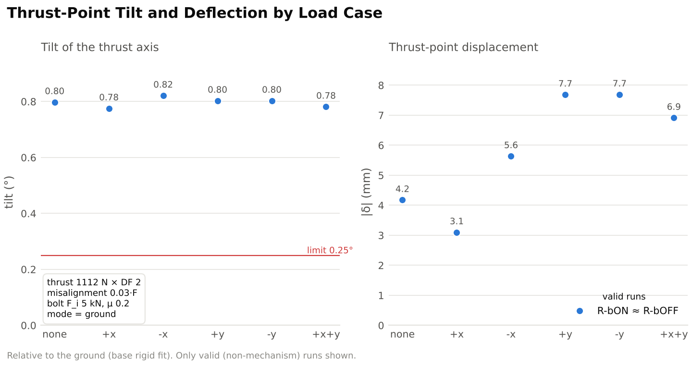

### Member axial force (load path)

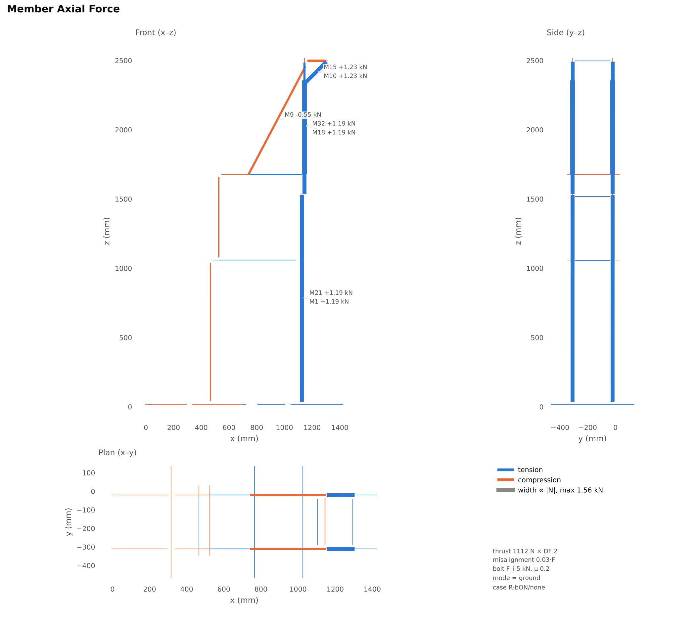

### Peak combined stress

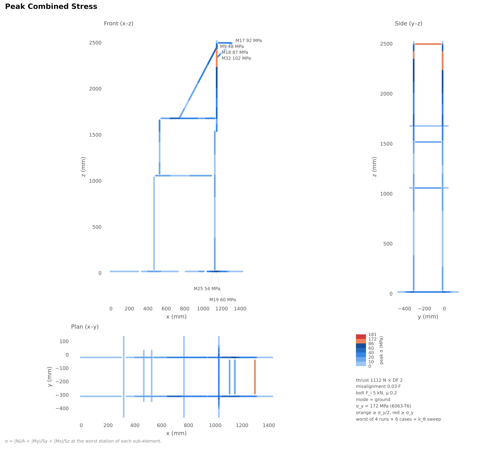

### Deflected shape (worst-tilt case)

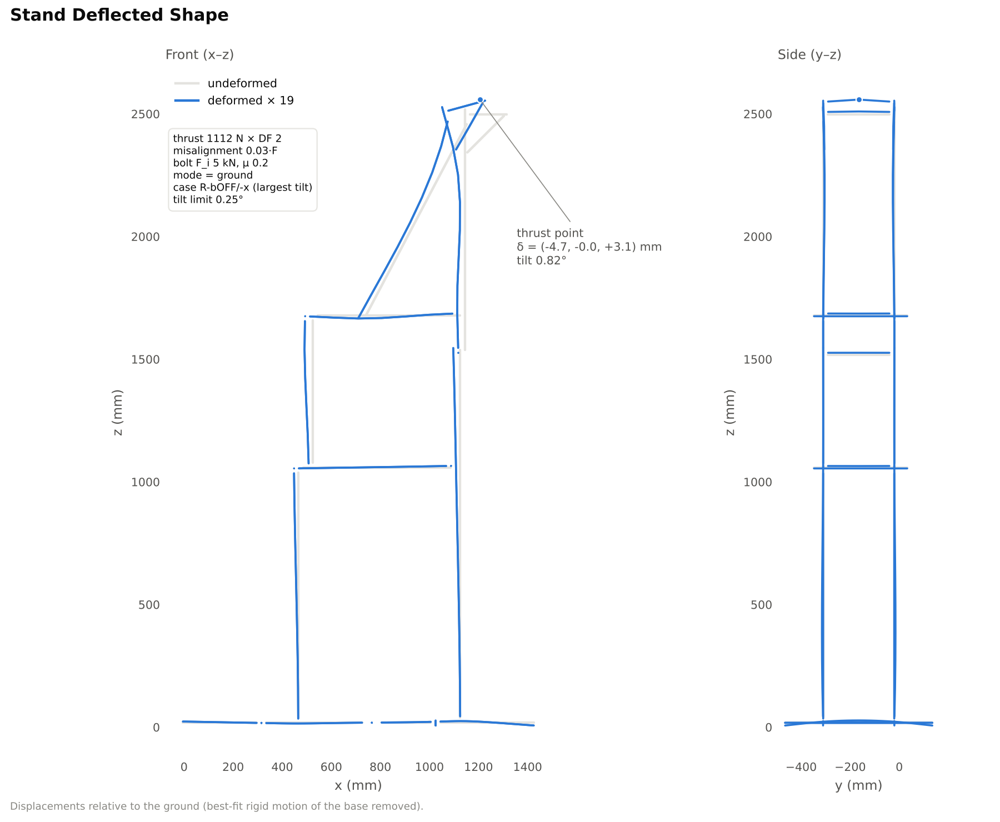

### Frame buckling mode

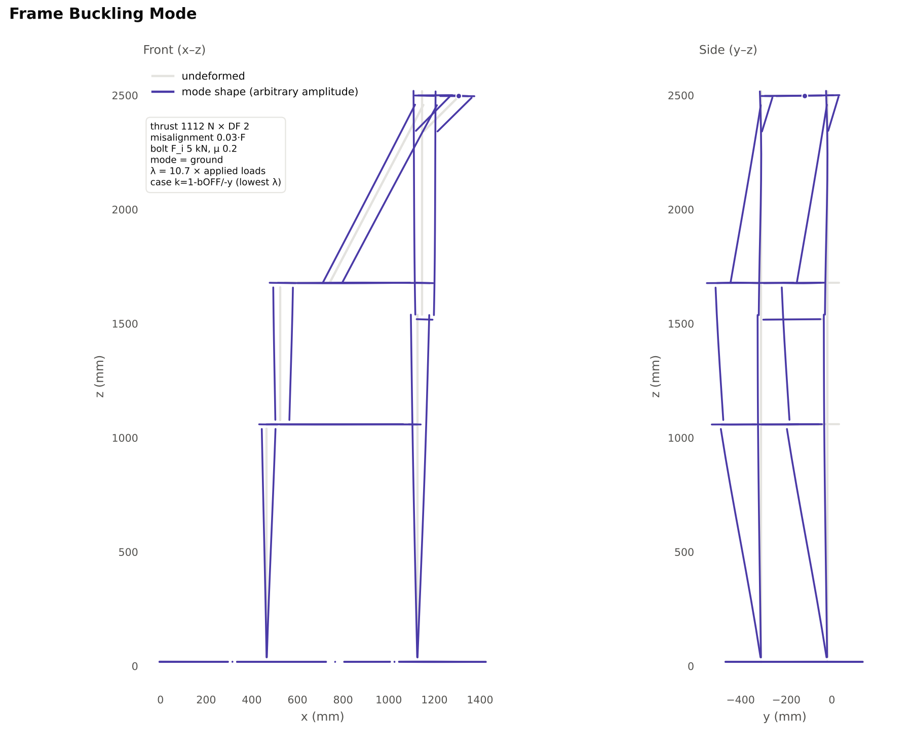

### Ground reaction on the base (governing case)

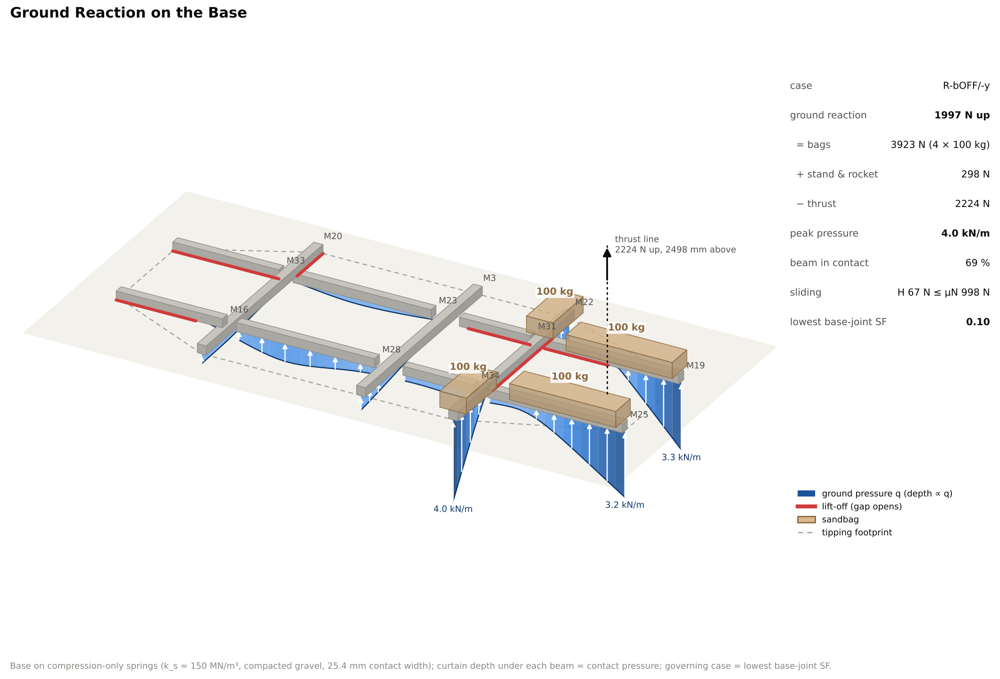

### Ground reaction by load case (plan)

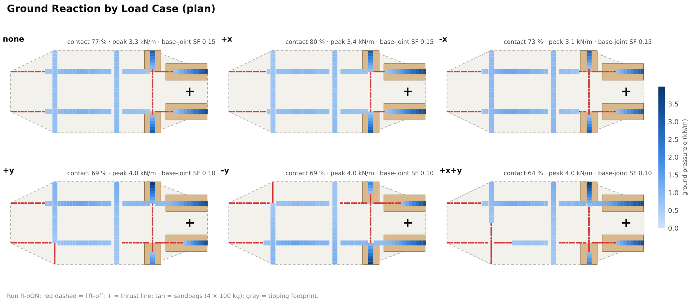

### SF vs joint rotational stiffness

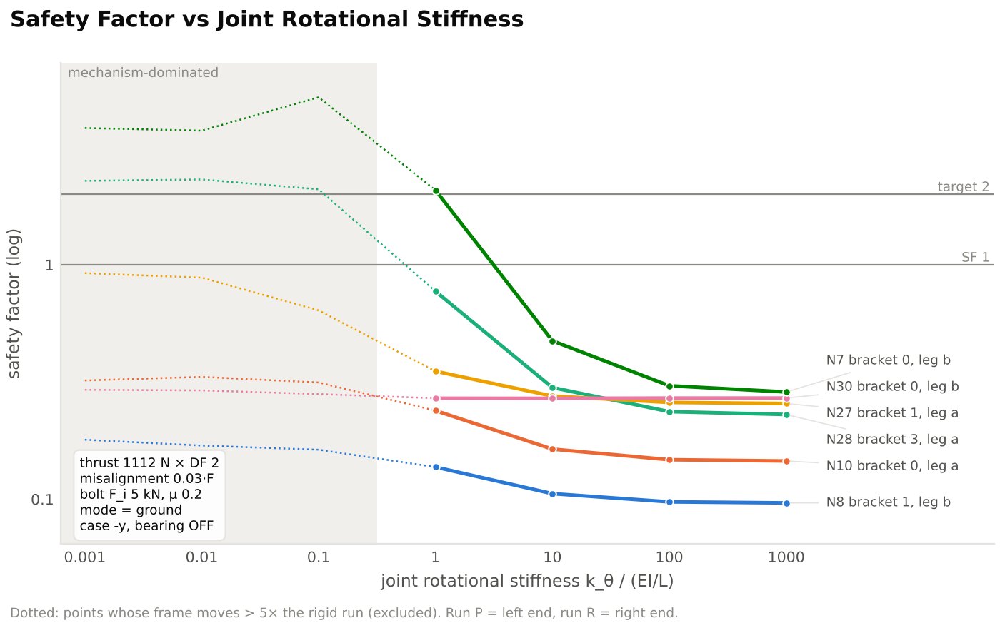

