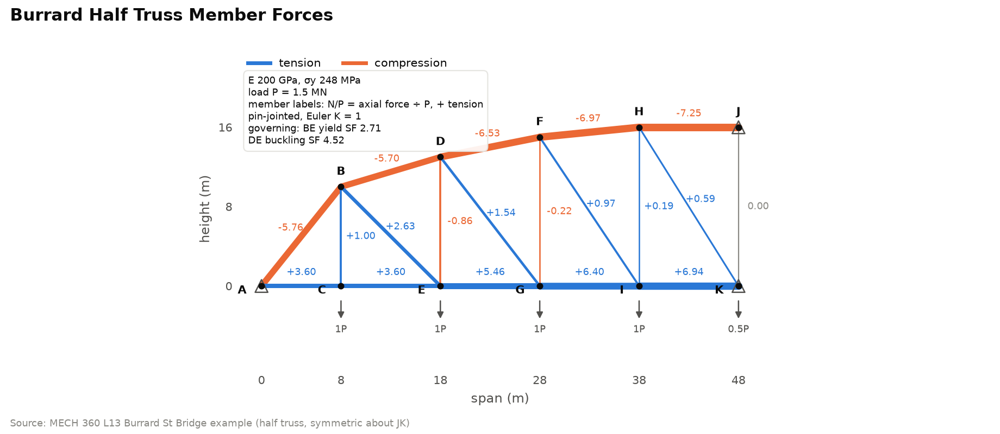

# Burrard truss back test

The solver against a published worked example — same `fem.py` element, assembly and
force recovery the stand runs on, so agreement here is what licenses trusting those
pieces on a frame nobody has solved by hand.

**19 of 19 members match to 3 decimals — every digit the notes print.**
Governing BE yield 2.71 (notes 2.71) and DE buckling 4.52 (notes 4.52) both reproduce.

Source: MECH 360 L13 Burrard St Bridge example (half truss, symmetric about JK).
`N/P` is the member's axial force **N** divided by the applied unit load **P = 1.5 MN** — the form the course notes tabulate, independent of P. Positive is tension.
E = 200 GPa, σy = 248 MPa, pin-jointed, Euler K = 1.

## Member forces

| member | N (MN) | N/P | notes N/P | match |
|---|---|---|---|---|
| HJ | -10.875 | -7.250 | -7.250 | yes |
| FH | -10.458 | -6.972 | -6.972 | yes |
| DF | -9.790 | -6.527 | -6.527 | yes |
| AB | -8.644 | -5.763 | -5.763 | yes |
| BD | -8.553 | -5.702 | -5.702 | yes |
| DE | -1.292 | -0.862 | -0.862 | yes |
| FG | -0.330 | -0.220 | -0.220 | yes |
| JK | +0.000 | +0.000 | +0.000 | yes |
| HI | +0.291 | +0.194 | +0.194 | yes |
| HK | +0.884 | +0.590 | +0.590 | yes |
| FI | +1.453 | +0.969 | +0.969 | yes |
| BC | +1.500 | +1.000 | +1.000 | yes |
| DG | +2.309 | +1.539 | +1.539 | yes |
| BE | +3.949 | +2.633 | +2.633 | yes |
| AC | +5.400 | +3.600 | +3.600 | yes |
| CE | +5.400 | +3.600 | +3.600 | yes |
| EG | +8.192 | +5.462 | +5.462 | yes |
| GI | +9.600 | +6.400 | +6.400 | yes |
| IK | +10.406 | +6.938 | +6.938 | yes |

## Safety factors

Both checks for every member, against the notes' own table. `P_crit` is the Euler
critical load behind each buckling SF — it is printed too, so it is checked as well.
A dash means the member is in tension and has no buckling check.

| member | SF yield | notes | P_crit MN | notes | SF buckling | notes |
|---|---|---|---|---|---|---|
| BE | 2.71 | 2.71 |   |   |   |   |
| HJ | 3.03 | 3.03 | 232.92 | 232.92 | 21.42 | 21.42 |
| FH | 3.15 | 3.15 | 230.62 | 230.62 | 22.05 | 22.05 |
| IK | 3.17 |   |   |   |   |   |
| BC | 3.21 | 3.21 |   |   |   |   |
| DF | 3.37 | 3.37 | 223.96 | 223.96 | 22.88 | 22.88 |
| GI | 3.44 | 3.44 |   |   |   |   |
| DG | 3.66 | 3.66 |   |   |   |   |
| DE | 3.72 | 3.72 | 5.84 | 5.84 | 4.52 | 4.52 |
| AB | 3.82 | 3.88 | 142.03 | 142.03 | 16.43 | 16.69 |
| BD | 3.86 | 3.86 | 213.69 | 213.69 | 24.98 | 24.98 |
| EG | 4.03 | 4.03 |   |   |   |   |
| FI | 5.82 | 5.82 |   |   |   |   |
| AC | 6.11 | 6.11 |   |   |   |   |
| CE | 6.11 | 6.11 |   |   |   |   |
| HK | 9.48 | 9.47 |   |   |   |   |
| FG | 13.00 | 13.00 | 2.63 | 2.63 | 7.98 | 7.98 |
| HI | 16.55 | 16.53 |   |   |   |   |
| JK | — |   |   |   |   |   |

Every buckling safety factor reproduces, and so does every `P_crit`. **AB is the
one row that differs** — the notes print 16.69, which is their P_crit 142.03 MN over
the transposed T = 8.51 MN. Over the corrected 8.644 MN it is 16.43, which is what
this model gives and what their own correction states (16.4).

JK carries no force, so its yield SF is infinite and it has no buckling check.

Course notes print AB = 5.673P (digit transposition); statics gives 4.5P*12.81/10 = 5.763P. Notes table AB row should be T=-8.64 MN, sigma=-65.0 MPa, fs_yield=3.82, fs_buck=16.4. Mins unchanged. Notes use Euler only.

