# Mojave Sphinx stand — 2D safety summary

params: `params.yaml` · 12 solves + 7 sweep · targets: member SF ≥ 2, joint SF ≥ 2 (DF = 2 already in the loads)

**Parameters changed from defaults**

- `bolts.M_twist_Nm`: 0 → **36** Nm (--set)

> 2D: cross members kept as joint stubs (load path between front members): M26@N18, M20@N2, M35@N20, M36@N28, M3@N6, M22@N8

> 2D: thrust/rocket loads (x0.5) moved from M17 to M14 at N30

## Headline

| quantity | value | governing |
|---|---|---|
| lowest joint SF | **0.31** (N22 plate_t5 leg B on M7, U_shear) | k=1-bON/-x |
| lowest member SF | **1.92** (M32 yield) | k=1-bON/-x |
| frame buckling λ | **42.09** (pass vs 2) | k=1-bON/-x |
| thrust-point deflection | 43.37 mm (x -42.06, y +0.00, z +10.59) | k=1-bON/-x |
| thrust-point tilt | 2.246° **> 0.25° flag** | k=1-bON/-x |
| sandbag mass (net uplift / g, FS 1) | **98.2 kg** (963 N) | all cases |
| sandbag mass if spread uniformly on the base | 369 kg (overturning 681 N·m about the base centroid) | worst case |
| 3-2-1 restraint reactions | 4.9e-10 × thrust (ok) | all valid solves |

Displacements are relative to the best-fit rigid motion of the base nodes (i.e. to the ground).

**In this folder:** [figures](#figures) (below, and in `figures/`) · `viewer.html` (interactive 3D, click any bracket for its free-body diagram; download and open locally) · `tables/members.csv`, `tables/joints.csv`, `tables/ktheta_sweep.csv` · `params_used.yaml` (exact inputs of this run)

## Lowest 10 joint SFs

SF = 1/U with U = Σ term demand/capacity (linear interaction). *Share* = that term's part of U; *SF if alone* = the SF if only that term acted.

| SF | joint | bracket | type | leg | on | governs | share | SF if alone | run/case |
|---|---|---|---|---|---|---|---|---|---|
| 0.31 | N22 | 0 | plate_t5 | B | M7 | slip (shear) | 100 % | 0.31 | k=1-bON/-x |
| 0.45 | N22 | 0 | plate_t5 | A | M6 | slip (shear) | 100 % | 0.45 | k=1-bON/-x |
| 0.51 | N8 | 1 | triangle | a | M19 | twist Mz | 77 % | 0.65 | R-bON/-x |
| 0.54 | N2 | 1 | triangle | a | M23 | twist Mz | 86 % | 0.63 | R-bOFF/-x |
| 0.57 | N10 | 0 | triangle | a | M21 | slip (shear) | 75 % | 0.75 | k=1-bON/-x |
| 0.62 | N18 | 0 | triangle | b | M32 | slip (shear) | 84 % | 0.74 | R-bOFF/-x |
| 0.63 | N26 | 0 | plate_t5 | B | M15 | slip (shear) | 100 % | 0.63 | k=1-bON/-x |
| 0.63 | N18 | 1 | triangle | a | M21 | slip (shear) | 86 % | 0.74 | R-bOFF/-x |
| 0.65 | N2 | 0 | triangle | a | M33 | twist Mz | 83 % | 0.78 | R-bOFF/-x |
| 0.65 | N8 | 0 | triangle | a | M31 | twist Mz | 74 % | 0.89 | R-bON/+x |

## Lowest 10 member SFs

| SF | member | profile | governs | σ (MPa) | N (N) | My (N·m) | Mz (N·m) | SF yield | SF buckle | SF beam-col | run/case |
|---|---|---|---|---|---|---|---|---|---|---|---|
| 1.92 | M32 | 1010 | yield | 89.5 | 500 | -0.0 | -127.1 | 1.92 | 194588.64 | 77284.86 | k=1-bON/-x |
| 2.16 | M19 | 1010 | yield | 79.6 | 8 | 0.0 | -115.3 | 2.16 | 2750.78 | 2.36 | k=10-bON/-x |
| 2.69 | M23 | 1010 | beam-col | 63.9 | -11 | -0.0 | 92.5 | 2.69 | 3660.18 | 2.69 | R-bOFF/-x |
| 3.85 | M7 | 1010 | beam-col | 38.8 | -624 | -0.0 | 53.0 | 4.43 | 25.65 | 3.85 | R-bOFF/-x |
| 4.16 | M6 | 1010 | beam-col | 41.3 | -31 | -0.0 | 59.7 | 4.16 | 516.98 | 4.16 | k=1-bON/-x |
| 5.25 | M15 | 1010 | yield | 32.8 | 1659 | -0.0 | -39.0 | 5.25 | inf | inf | k=1-bON/-x |
| 5.38 | M33 | 1010 | beam-col | 32.0 | -8 | -0.0 | 46.3 | 5.38 | 4007.00 | 5.38 | R-bOFF/-x |
| 6.11 | M31 | 1010 | yield | 28.1 | 21 | 0.0 | -40.7 | 6.11 | 34118.79 | 9.15 | R-bON/+x |
| 6.84 | M29 | 1010 | beam-col | 21.1 | -341 | -0.0 | -28.9 | 8.14 | 36.36 | 6.84 | R-bOFF/-x |
| 8.47 | M5 | 1010 | beam-col | 19.5 | -340 | -0.0 | 26.5 | 8.81 | 92.43 | 8.47 | R-bOFF/-x |

## Mechanism checks

- **Run P invalid** for cases none, +x, -x: a node moves more than 1 mm → *mechanism — pinned result invalid; joints carry moment*. Run R used for those cases.
- P-bON: lowest K eigenvalue / max diag = 4.73e-13 **(mechanism)**; softest mode dominated by node 87 (M33 s=0 mm) ry, node 88 (M33 s=100 mm) ry, node 89 (M33 s=200 mm) ry
- P-bOFF: lowest K eigenvalue / max diag = 1.49e-13 **(mechanism)**; softest mode dominated by node 86 (M32 s=980 mm) ux, node 94 (M36 s=250 mm) ux, node 33 (M14 s=150 mm) ux
- R-bON: lowest K eigenvalue / max diag = 5.73e-10; softest mode dominated by node 86 (M32 s=980 mm) ux, node 33 (M14 s=150 mm) ux, node 32 (M14 s=134 mm) ux
- R-bOFF: lowest K eigenvalue / max diag = 5.73e-10; softest mode dominated by node 86 (M32 s=980 mm) ux, node 33 (M14 s=150 mm) ux, node 32 (M14 s=134 mm) ux

## k_θ sweep (-x, bearing ON)

| k_θ / (EI/L) | max node δ (mm) | valid | λ | lowest SF |
|---|---|---|---|---|
| 0.001 | 2.64e+04 | no | 1.18 | 0.01 (N14#0.0:a) |
| 0.01 | 2.71e+03 | no | 11.64 | 0.01 (N14#0.0:a) |
| 0.1 | 303 | no | 37.05 | 0.03 (N14#0.0:a) |
| 1 | 43.6 | yes | 42.09 | 0.31 (N22#0.0:B) |
| 10 | 17 | yes | 62.18 | 0.54 (N8#1.0:a) |
| 100 | 14.3 | yes | 78.54 | 0.51 (N8#1.0:a) |
| 1000 | 14 | yes | 81.24 | 0.51 (N8#1.0:a) |

Items whose utilisation peaks at an interior k_θ (value used in the envelope):

- M19: U = 0.463 at k = 10 (ends 0.463 / 0.463)
- M23: U = 0.372 at k = 10 (ends 0.372 / 0.372)
- N10#0.0:b: U = 0.983 at k = 100 (ends 0.303 / 0.976)
- N12#0.0:b: U = 0.084 at k = 10 (ends 0.084 / 0.066)
- N14#0.0:a: U = 0.146 at k = 100 (ends 0.012 / 0.142)
- N14#0.0:b: U = 0.168 at k = 10 (ends 0.036 / 0.151)
- N2#0.0:a: U = 1.547 at k = 10 (ends 1.547 / 1.547)
- N2#0.0:b: U = 1.221 at k = 10 (ends 1.221 / 1.221)
- N2#1.0:a: U = 1.840 at k = 10 (ends 1.840 / 1.840)
- N2#1.0:b: U = 1.222 at k = 10 (ends 1.222 / 1.222)
- N28#1.0:b: U = 0.284 at k = 10 (ends 0.203 / 0.252)
- N28#2.0:a: U = 0.332 at k = 10 (ends 0.220 / 0.302)

## Joint capacities used

- friction per bolt μF_i = 1000 N, pull F_i = 5000 N, triangle tilt M = F_i·a = 63.5 N·m, twist μF_i·r_f = 36.00 N·m (r_f = 4.63 mm)
- T-plate sections (computed from the outline): A line b_net = 54.8 mm (brief 54.8); B line 49.2 mm (brief 36.5); B through lower hole 43.7 mm (brief 56.4); stem neck 76.2 mm (added check)

## Unverified inputs

| parameter | value | flag | meaning |
|---|---|---|---|
| `triangle.tilt_arm_mm` | 12.7 mm | placeholder | gap-opening arm a: Mx,max = My,max = F_i*a |
| `plate.thickness_mm` | 6.35 mm | placeholder | plate thickness t |
| `section_1010.J_mm4` | auto mm4 | unverified | torsion constant; auto = 0.5*(Iy+Iz) |
| `section_1020.J_mm4` | auto mm4 | unverified | torsion constant; auto = 0.5*(Iy+Iz) |
| `loads.misalign_x` | 0.03 - | assumption | horizontal x load as fraction of factored thrust |
| `loads.misalign_y` | 0.03 - | assumption | horizontal y load as fraction of factored thrust |
| `bolts.preload_N` | 5000 N | assumption | 1/4-20 bolt preload F_i |
| `bolts.mu` | 0.2 - | assumption | friction coefficient, one surface |
| `bolts.M_twist_Nm` | 36 Nm | assumption | twist capacity about the bolt axis per leg; 0 = computed as mu*F_i*r_f (one bolt, friction only). Set it to model a fix that resists twist: a second bolt, a key, a pinned bracket |
| `base.mode` | line | assumption | line = brief: sandbag line load that exactly balances the stand | ground = base on compression-only gravel springs + discrete sandbags (3D only; `run --ground`) |
| `ground.k_s_MN_per_m3` | 150 MN/m3 | assumption | modulus of subgrade reaction, compacted gravel (typical 100-200) |
| `ground.kh_ratio` | 0.5 - | assumption | horizontal / vertical contact stiffness (friction, sticking) |
| `ground.mu` | 0.5 - | assumption | aluminium on gravel friction, for the sliding check |
| `sandbags.stations` | [[19, 225, 300], [25, 225, 300], [22, 522.5, 155], [22, 77.5, 155]] | assumption | bags: [member, centre along member mm, length mm]; default = thrust-end outriggers M19/M25 under the thrust line + both stubs of cross beam M22 |
| `sandbags.FS_tip` | 1.5 - | assumption | stabilising / overturning moment about every footprint edge (and lift) |
| plate_other brackets | — | no capacity | forces reported only |

## Figures

### Safety factor by member and joint (front / side / plan)

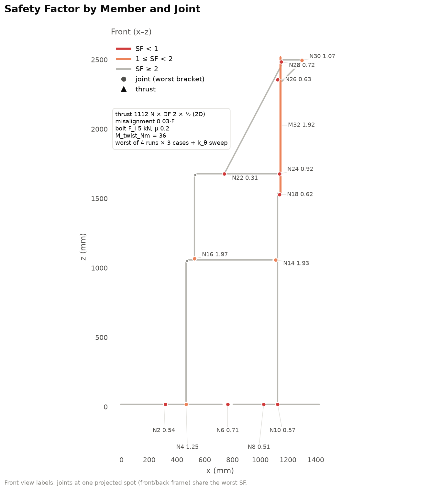

### Lowest safety factors

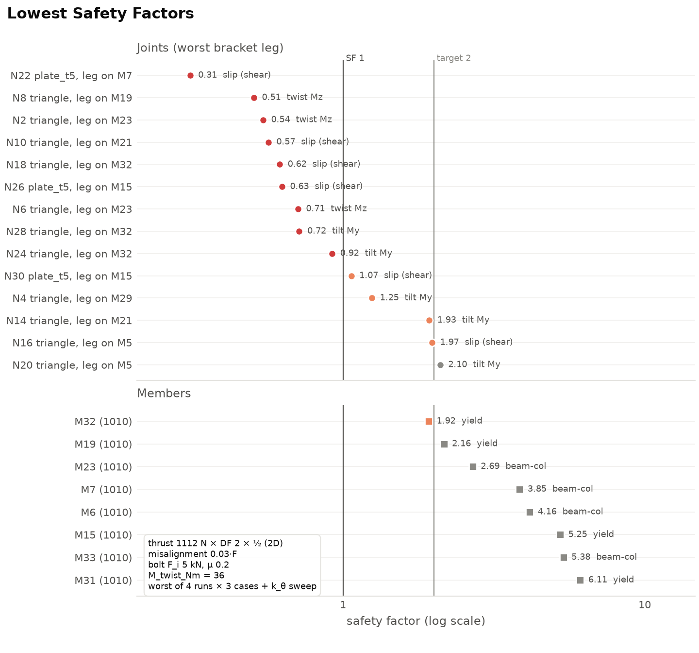

### Joint SF and the share of each failure term

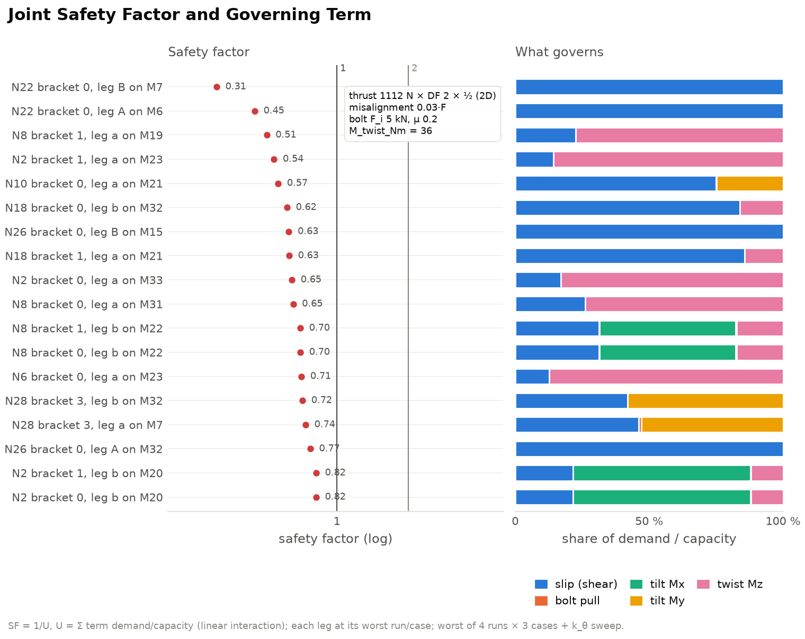

### SF of the critical items in every load case

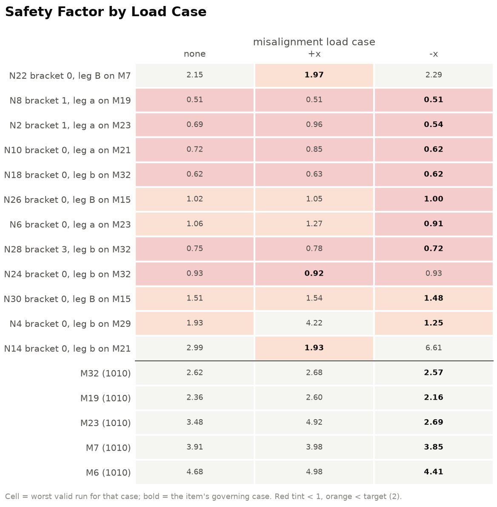

### Thrust-point tilt and deflection by load case

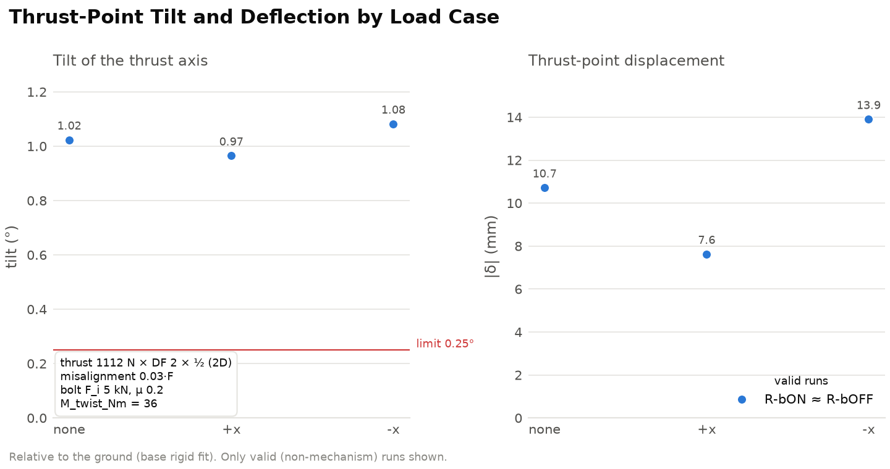

### Member axial force (load path)

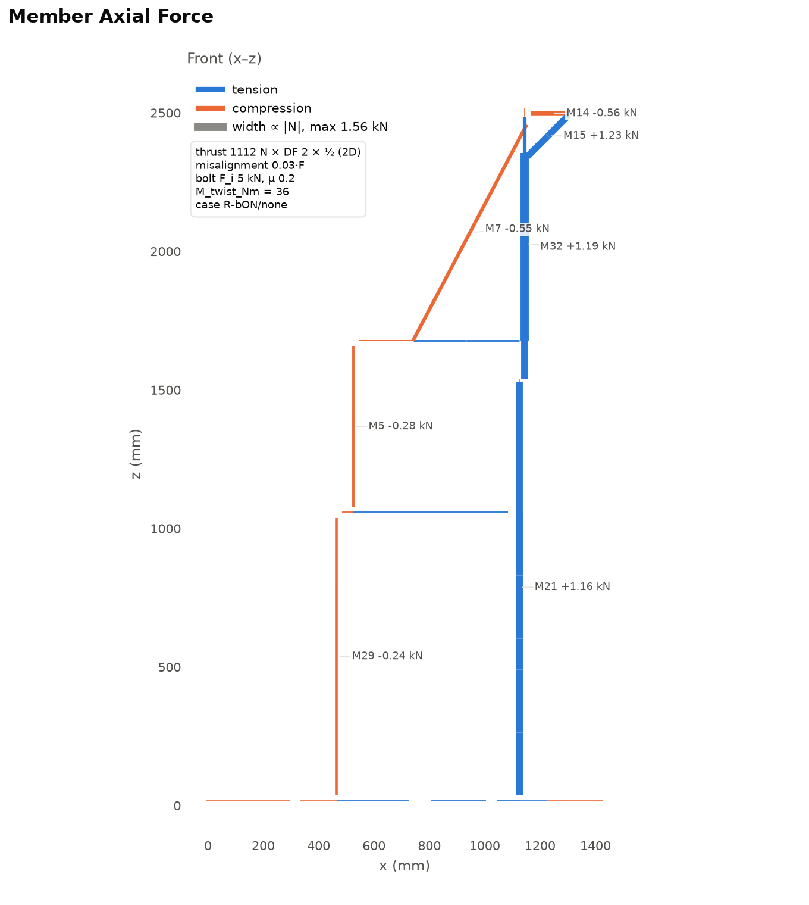

### Peak combined stress

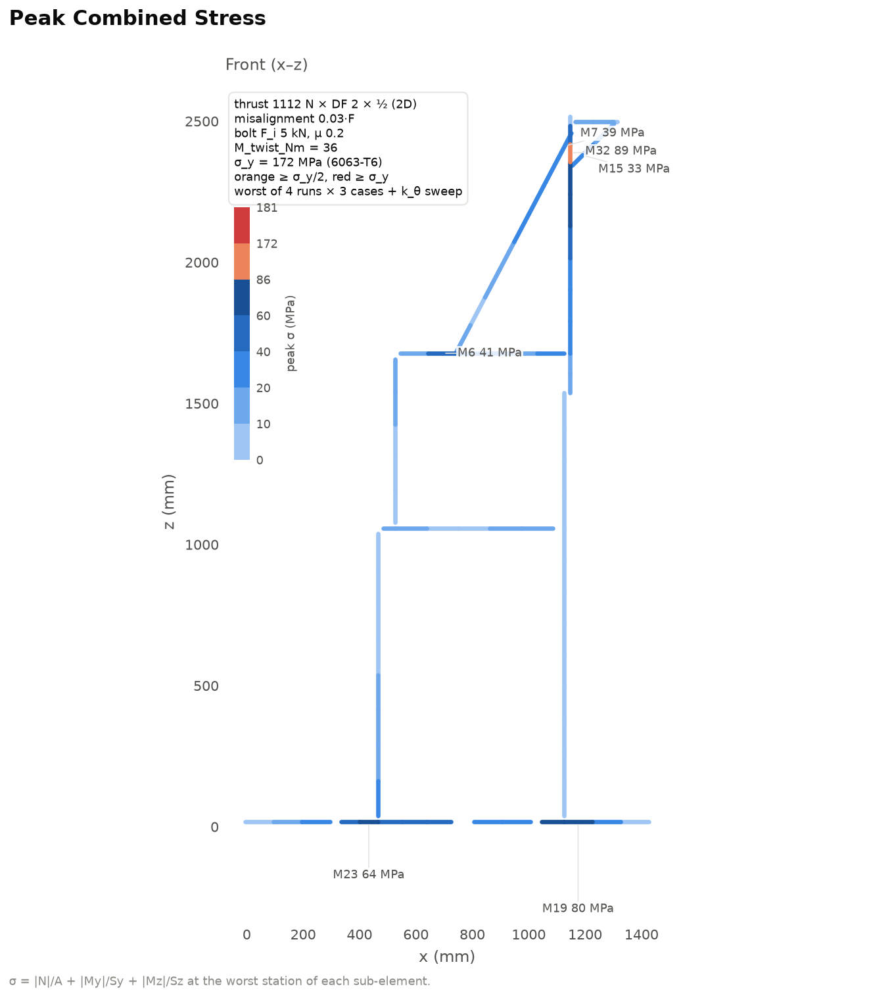

### Deflected shape (worst-tilt case)

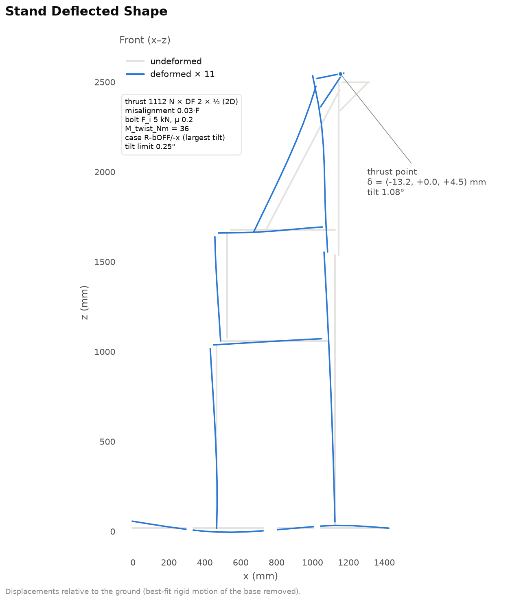

### Frame buckling mode

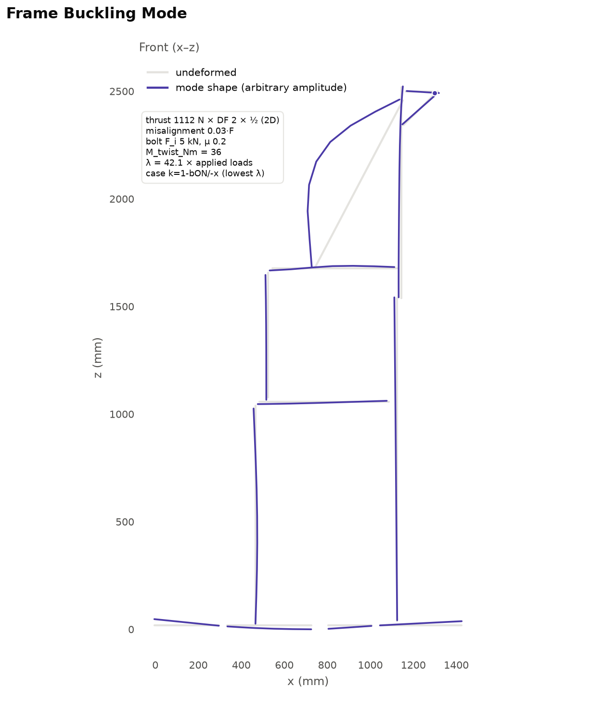

### Sandbag demand on the base

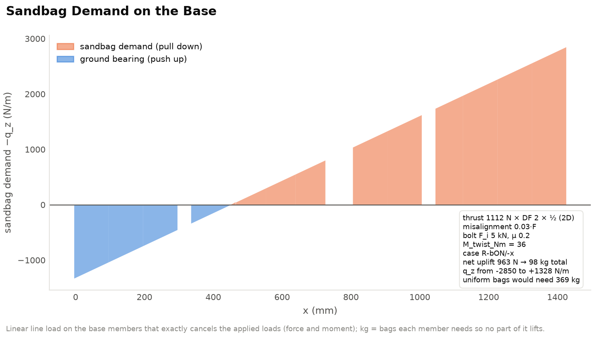

### SF vs joint rotational stiffness

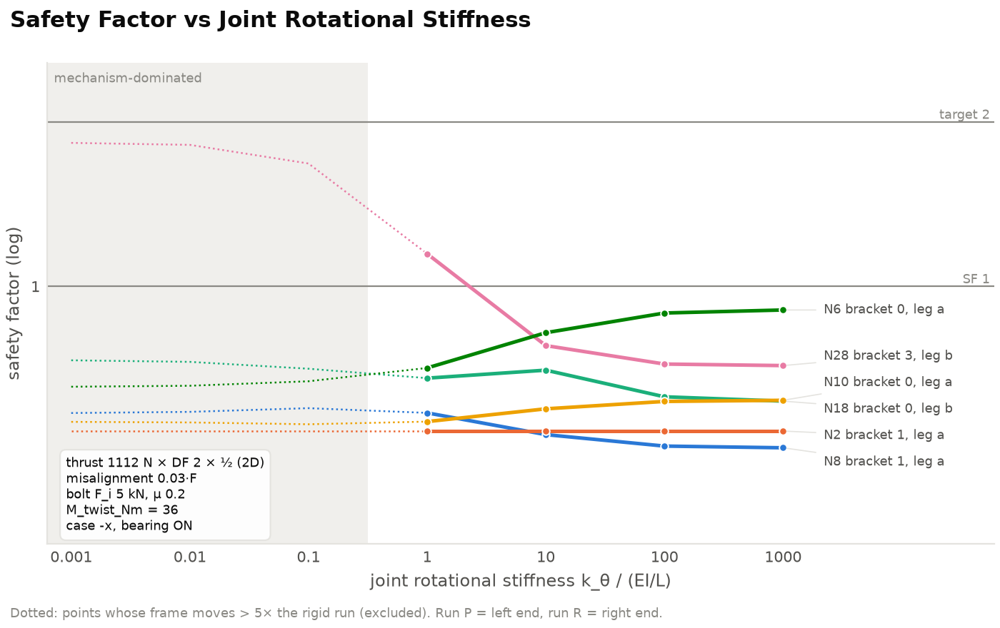

