# Mojave Sphinx stand — 3D safety summary

params: `params_v2.yaml` · 24 solves + 7 sweep · targets: member SF ≥ 2, joint SF ≥ 2 (DF = 2 already in the loads)

**Parameters changed from defaults**

- `inputs.geometry`: references/prompt/geometry.json → **references/v2/geometry.json**  (params_v2.yaml)
- `inputs.brackets`: references/prompt/brackets.json → **references/v2/brackets.json**  (params_v2.yaml)
- `material.sigma_y_MPa`: 172 → **145** MPa (params_v2.yaml)
- `section_4040.A_mm2`: 1058.6 → **600** mm2 (params_v2.yaml)
- `section_4040.I_strong_mm4`: 151020 → **90000** mm4 (params_v2.yaml)
- `section_4040.I_weak_mm4`: 151020 → **90000** mm4 (params_v2.yaml)
- `section_4040.weight_N_per_m`: 28.04 → **15.9** N/m (params_v2.yaml)
- `section_4080.A_mm2`: 2388 → **1100** mm2 (params_v2.yaml)
- `section_4080.I_strong_mm4`: 1.16014e+06 → **500000** mm4 (params_v2.yaml)
- `section_4080.I_weak_mm4`: 307220 → **170000** mm4 (params_v2.yaml)
- `section_4080.weight_N_per_m`: 63.25 → **29.1** N/m (params_v2.yaml)
- `section_8080.A_mm2`: 3538.8 → **1950** mm2 (params_v2.yaml)
- `section_8080.I_strong_mm4`: 2.25776e+06 → **1.2e+06** mm4 (params_v2.yaml)
- `section_8080.I_weak_mm4`: 2.25776e+06 → **1.2e+06** mm4 (params_v2.yaml)
- `section_8080.weight_N_per_m`: 93.7 → **51.6** N/m (params_v2.yaml)
- `bolts.preload_N`: 5000 → **10000** N (params_v2.yaml)
- `bolts.hole_radius_mm`: 3.57 → **4.5** mm (params_v2.yaml)
- `bolts.head_radius_mm`: 5.55 → **6.5** mm (params_v2.yaml)
- `triangle.tilt_arm_mm`: 12.7 → **20** mm (params_v2.yaml)
- `triangle.face_width_mm`: 25.4 → **40** mm (params_v2.yaml)
- `triangle.min_leg_extent_mm`: 12.7 → **20** mm (params_v2.yaml)
- `plate.fy_MPa`: 172 → **145** MPa (params_v2.yaml)
- `plate.groupA_u_mm`: [-25.4, 0, 25.4] → **[-40, 0, 40]** mm (params_v2.yaml)
- `plate.groupB_v_mm`: [38.1, 63.5] → **[60, 100]** mm (params_v2.yaml)
- `plate.base_width_mm`: 76.2 → **120** mm (params_v2.yaml)
- `plate.base_half_height_mm`: 12.7 → **20** mm (params_v2.yaml)
- `plate.stem_taper_end_v_mm`: 63.5 → **100** mm (params_v2.yaml)
- `plate.stem_width_mm`: 25.4 → **40** mm (params_v2.yaml)
- `plate.top_edge_v_mm`: 76.2 → **120** mm (params_v2.yaml)
- `ground.contact_width_mm`: 25.4 → **80** mm (params_v2.yaml)
- `sandbags.stations`: [[19, 225, 300], [25, 225, 300], [22, 522.5, 155], [22, 77.5, 155]] → **[[6, 150, 300], [6, 1350, 300], [0, 150, 300], [0, 850, 300]]**  (params_v2.yaml)
- `output.dir`: results → **results_v2**  (params_v2.yaml)
- `base.mode`: line → **ground**  (--set)

> ground mode: 124 contact springs on 2 base members, no 3-2-1 restraint

## Headline

| quantity | value | governing |
|---|---|---|
| lowest joint SF | **0.21** (N6 triangle leg b on M10, U_Mz) | R-bOFF/+x+y |
| lowest member SF | **2.03** (M6 yield) | R-bON/-y |
| frame buckling λ | **4.37** (pass vs 2) | k=0.01-bOFF/+x+y |
| thrust-point deflection | 47.29 mm (x -29.87, y -14.62, z +33.62) | k=0.01-bOFF/+x+y |
| thrust-point tilt | 10.723° **> 0.25° flag** | k=0.01-bOFF/+x+y |
| sandbags (FS 1.5 on tipping and lift) | **4 × 135 kg = 540 kg** | tipping over footprint edge 0 (-1460,40)->(80,-710) mm, case -y |
| sandbag mass (net uplift / g, FS 1) | **178.6 kg** (1752 N) | all cases |

## Ground contact

Base on 124 compression-only contact springs (k_s = 150 MN/m³, compacted gravel; 80.0 mm wide; horizontal = 0.5 × vertical). No assumed base load: the ground pushes up only where the base presses down.

**Sandbags** (rigid-body statics, equal mass per station, rounded up to 5 kg):

| station | where | mass |
|---|---|---|
| M6 @ 150 mm, 300 mm long | x 80, y -560 mm | 135 kg |
| M6 @ 1350 mm, 300 mm long | x 80, y 640 mm | 135 kg |
| M0 @ 150 mm, 300 mm long | x -1310, y 40 mm | 135 kg |
| M0 @ 850 mm, 300 mm long | x -610, y 40 mm | 135 kg |

Sized by tipping over footprint edge 0 (-1460,40)->(80,-710) mm, case -y (needs 133.9 kg each before rounding).

| case | FS tipping | FS lift | contact | peak q kN/m | sliding FS (μ 0.5) | lowest base-joint SF |
|---|---|---|---|---|---|---|
| none | 1.64 | 2.59 | 39 % | 8.7 | ∞ | 0.26 |
| +x | 1.72 | 2.59 | 40 % | 9.0 | 26.6 | 0.30 |
| -x | 1.58 | 2.59 | 37 % | 8.1 | 26.6 | 0.21 |
| +y | 1.52 | 2.59 | 40 % | 9.2 | 26.6 | 0.31 |
| -y | 1.51 | 2.59 | 37 % | 9.1 | 26.6 | 0.22 |
| +x+y | 1.58 | 2.59 | 41 % | 9.1 | 18.8 | 0.36 |

**Sensitivity to ground stiffness** (run R, all cases):

| k_s MN/m³ | lowest base-joint SF | lowest joint SF | peak q kN/m | least contact |
|---|---|---|---|---|
| 50 | 0.21 | 0.21 | 5.6 | 44 % |
| 150 | 0.21 | 0.21 | 9.2 | 37 % |
| 500 | 0.22 | 0.21 | 15.9 | 33 % |

Displacements are relative to the best-fit rigid motion of the base nodes (i.e. to the ground).

**In this folder:** [figures](#figures) (below, and in `figures/`) · `viewer.html` (interactive 3D, click any bracket for its free-body diagram; download and open locally) · `tables/members.csv`, `tables/joints.csv`, `tables/ktheta_sweep.csv` · `params_used.yaml` (exact inputs of this run)

## Lowest 10 joint SFs

SF = 1/U with U = Σ term demand/capacity (linear interaction). *Share* = that term's part of U; *SF if alone* = the SF if only that term acted.

| SF | joint | bracket | type | leg | on | governs | share | SF if alone | run/case |
|---|---|---|---|---|---|---|---|---|---|
| 0.21 | N6 | 0 | triangle | b | M10 | twist Mz | 91 % | 0.23 | R-bOFF/+x+y |
| 0.21 | N6 | 1 | triangle | b | M10 | twist Mz | 91 % | 0.23 | R-bOFF/+x+y |
| 0.21 | N2 | 1 | triangle | a | M6 | twist Mz | 60 % | 0.36 | R-bON/-x |
| 0.21 | N2 | 2 | triangle | a | M6 | twist Mz | 60 % | 0.36 | R-bON/-x |
| 0.24 | N2 | 1 | triangle | b | M10 | twist Mz | 62 % | 0.38 | R-bOFF/-y |
| 0.24 | N2 | 2 | triangle | b | M10 | twist Mz | 62 % | 0.38 | R-bOFF/-y |
| 0.25 | N8 | 0 | triangle | a | M9 | twist Mz | 92 % | 0.27 | R-bOFF/+x+y |
| 0.25 | N7 | 0 | triangle | b | M1 | twist Mz | 93 % | 0.28 | R-bOFF/-y |
| 0.41 | N2 | 0 | triangle | a | M0 | slip (shear) | 59 % | 0.71 | R-bON/-x |
| 0.43 | N11 | 0 | triangle | a | M9 | twist Mz | 96 % | 0.45 | k=0.01-bOFF/+x+y |

## Lowest 10 member SFs

| SF | member | profile | governs | σ (MPa) | N (N) | My (N·m) | Mz (N·m) | SF yield | SF buckle | SF beam-col | run/case |
|---|---|---|---|---|---|---|---|---|---|---|---|
| 2.03 | M6 | 4080 | yield | 71.3 | 105 | -595.6 | -13.7 | 2.03 | 155.61 | 2.24 | R-bON/-y |
| 3.98 | M0 | 4080 | beam-col | 35.9 | -93 | -301.5 | 3.7 | 4.04 | 231.91 | 3.98 | R-bON/-x |
| 6.79 | M12 | 4040 | beam-col | 21.3 | -30 | -18.0 | 77.8 | 6.79 | 2600.46 | 6.79 | k=0.01-bOFF/+x+y |
| 7.83 | M3 | 4080 | beam-col | 15.1 | -1092 | -26.4 | 137.0 | 9.62 | 34.15 | 7.83 | R-bOFF/-x |
| 8.05 | M10 | 8080 | yield | 18.0 | 1943 | 471.8 | 38.8 | 8.05 | inf | inf | R-bON/-x |
| 10.64 | M2 | 4080 | yield | 13.6 | 1101 | -11.8 | 140.5 | 10.64 | 8249.06 | 8130.96 | R-bOFF/-x |
| 12.43 | M5 | 4080 | beam-col | 11.6 | -191 | -95.8 | 2.4 | 12.46 | 777.34 | 12.43 | k=0.01-bOFF/+x+y |
| 15.34 | M4 | 4040 | beam-col | 9.4 | 0 | 13.2 | 29.2 | 15.37 | 6142.10 | 15.34 | k=0.01-bOFF/+x+y |
| 15.65 | M7 | 4080 | beam-col | 9.1 | -631 | -72.0 | 1.2 | 15.87 | 215.51 | 15.65 | k=0.01-bOFF/+x+y |
| 17.05 | M9 | 4040 | yield | 8.5 | 90 | 6.5 | 31.1 | 17.05 | 57311.40 | 1535.51 | R-bOFF/+x+y |

## Mechanism checks

- **Run P invalid** for cases none, +x, -x, +y, -y, +x+y: a node moves more than 1 mm → *mechanism — pinned result invalid; joints carry moment*. Run R used for those cases.
- P-bON: lowest K eigenvalue / max diag = 1.92e-12; softest mode dominated by node 62 (M1 s=0 mm) rz, node 165 (M9 s=0 mm) rz, node 63 (M1 s=46 mm) rz
- P-bOFF: lowest K eigenvalue / max diag = 2.28e-12; softest mode dominated by node 62 (M1 s=0 mm) rz, node 165 (M9 s=0 mm) rz, node 63 (M1 s=46 mm) rz
- R-bON: lowest K eigenvalue / max diag = 8.05e-10; softest mode dominated by node 96 (M5 s=380 mm) rz, node 164 (M7 s=600 mm) rz, node 95 (M5 s=360 mm) rz
- R-bOFF: lowest K eigenvalue / max diag = 1.00e-09; softest mode dominated by node 96 (M5 s=380 mm) rz, node 164 (M7 s=600 mm) rz, node 95 (M5 s=360 mm) rz

## k_θ sweep (+x+y, bearing OFF)

| k_θ / (EI/L) | max node δ (mm) | valid | λ | lowest SF |
|---|---|---|---|---|
| 0.001 | 569 | no | 0.46 | 0.28 (N6#0.0:b) |
| 0.01 | 79.3 | yes | 4.37 | 0.28 (N6#0.0:b) |
| 0.1 | 34.3 | yes | 35.39 | 0.28 (N6#0.0:b) |
| 1 | 27.9 | yes | 164.26 | 0.25 (N6#0.0:b) |
| 10 | 23.3 | yes | 299.27 | 0.22 (N6#0.0:b) |
| 100 | 21.4 | yes | 330.68 | 0.21 (N6#0.0:b) |
| 1000 | 21.1 | yes | 334.27 | 0.21 (N6#0.0:b) |

Items whose utilisation peaks at an interior k_θ (value used in the envelope):

- M10: U = 0.085 at k = 1 (ends 0.085 / 0.085)
- N11#0.0:b: U = 0.760 at k = 1 (ends 0.749 / 0.758)
- N2#1.0:b: U = 2.785 at k = 100 (ends 0.671 / 2.783)
- N2#2.0:b: U = 2.785 at k = 100 (ends 0.671 / 2.783)
- N9#0.0:b: U = 0.787 at k = 1 (ends 0.775 / 0.780)

## Joint capacities used

- friction per bolt μF_i = 2000 N, pull F_i = 10000 N, triangle tilt M = F_i·a = 200.0 N·m, twist μF_i·r_f = 11.12 N·m (r_f = 5.56 mm)
- T-plate sections (computed from the outline): A line b_net = 93.0 mm (brief 54.8); B line 82.0 mm (brief 36.5); B through lower hole 71.0 mm (brief 56.4); stem neck 120.0 mm (added check)

## Unverified inputs

| parameter | value | flag | meaning |
|---|---|---|---|
| `triangle.tilt_arm_mm` | 20 mm | placeholder | gap-opening arm a: Mx,max = My,max = F_i*a |
| `plate.thickness_mm` | 6.35 mm | placeholder | plate thickness t |
| `section_1010.J_mm4` | auto mm4 | unverified | torsion constant; auto = 0.5*(Iy+Iz) |
| `section_1020.J_mm4` | auto mm4 | unverified | torsion constant; auto = 0.5*(Iy+Iz) |
| `section_4040.A_mm2` | 600 mm2 | unverified | CAD profile |
| `section_4040.I_strong_mm4` | 90000 mm4 | unverified | CAD profile (square) |
| `section_4040.I_weak_mm4` | 90000 mm4 | unverified | CAD profile |
| `section_4040.J_mm4` | auto mm4 | unverified | torsion constant; auto = 0.5*(Iy+Iz) |
| `section_4040.weight_N_per_m` | 15.9 N/m | unverified | A x 2700 kg/m3 x g (CAD area) |
| `section_4080.A_mm2` | 1100 mm2 | unverified | CAD profile |
| `section_4080.I_strong_mm4` | 500000 mm4 | unverified | CAD profile, depth (80) along strong_axis_depth_along |
| `section_4080.I_weak_mm4` | 170000 mm4 | unverified | CAD profile |
| `section_4080.J_mm4` | auto mm4 | unverified | torsion constant; auto = 0.5*(Iy+Iz) |
| `section_4080.weight_N_per_m` | 29.1 N/m | unverified | A x 2700 kg/m3 x g (CAD area) |
| `section_8080.A_mm2` | 1950 mm2 | unverified | CAD profile |
| `section_8080.I_strong_mm4` | 1.2e+06 mm4 | unverified | CAD profile (square) |
| `section_8080.I_weak_mm4` | 1.2e+06 mm4 | unverified | CAD profile |
| `section_8080.J_mm4` | auto mm4 | unverified | torsion constant; auto = 0.5*(Iy+Iz) |
| `section_8080.weight_N_per_m` | 51.6 N/m | unverified | A x 2700 kg/m3 x g (CAD area) |
| `loads.misalign_x` | 0.03 - | assumption | horizontal x load as fraction of factored thrust |
| `loads.misalign_y` | 0.03 - | assumption | horizontal y load as fraction of factored thrust |
| `bolts.preload_N` | 10000 N | assumption | 1/4-20 bolt preload F_i |
| `bolts.mu` | 0.2 - | assumption | friction coefficient, one surface |
| `bolts.M_twist_Nm` | 0 Nm | assumption | twist capacity about the bolt axis per leg; 0 = computed as mu*F_i*r_f (one bolt, friction only). Set it to model a fix that resists twist: a second bolt, a key, a pinned bracket |
| `base.mode` | ground | assumption | line = brief: sandbag line load that exactly balances the stand | ground = base on compression-only gravel springs + discrete sandbags (3D only; `run --ground`) |
| `ground.k_s_MN_per_m3` | 150 MN/m3 | assumption | modulus of subgrade reaction, compacted gravel (typical 100-200) |
| `ground.kh_ratio` | 0.5 - | assumption | horizontal / vertical contact stiffness (friction, sticking) |
| `ground.mu` | 0.5 - | assumption | aluminium on gravel friction, for the sliding check |
| `sandbags.stations` | [[6, 150, 300], [6, 1350, 300], [0, 150, 300], [0, 850, 300]] | assumption | bags: [member, centre along member mm, length mm]; default = thrust-end outriggers M19/M25 under the thrust line + both stubs of cross beam M22 |
| `sandbags.FS_tip` | 1.5 - | assumption | stabilising / overturning moment about every footprint edge (and lift) |
| plate_other brackets | — | no capacity | forces reported only |

## Figures

### layout

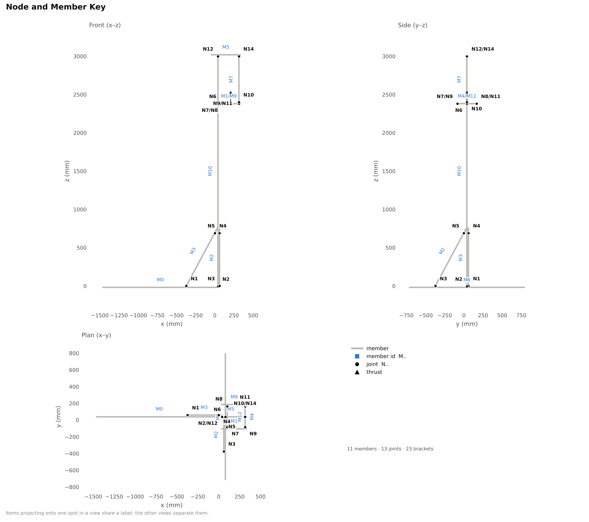

### Safety factor by member and joint (front / side / plan)

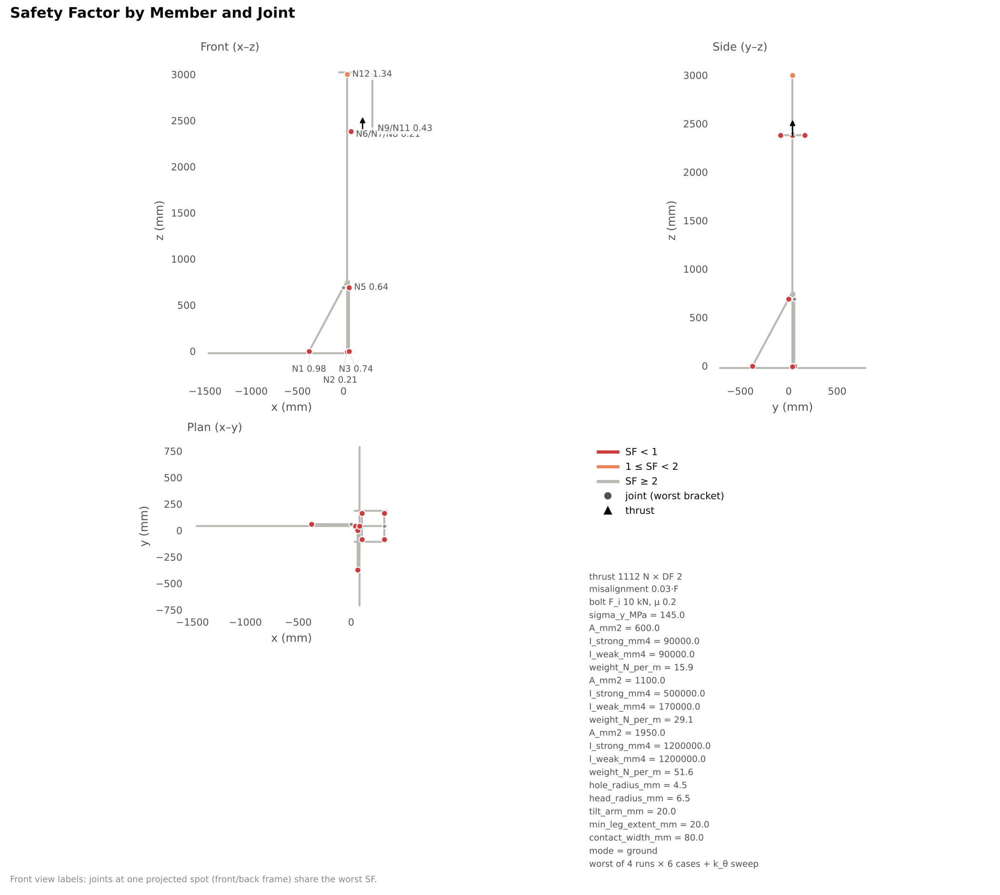

### Lowest safety factors

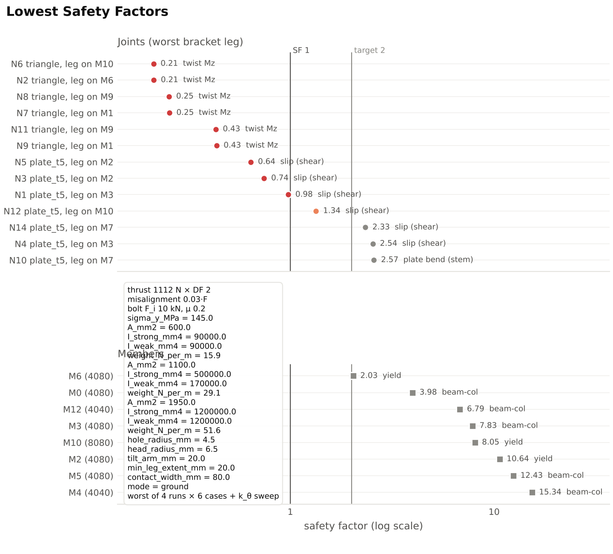

### Joint SF and the share of each failure term

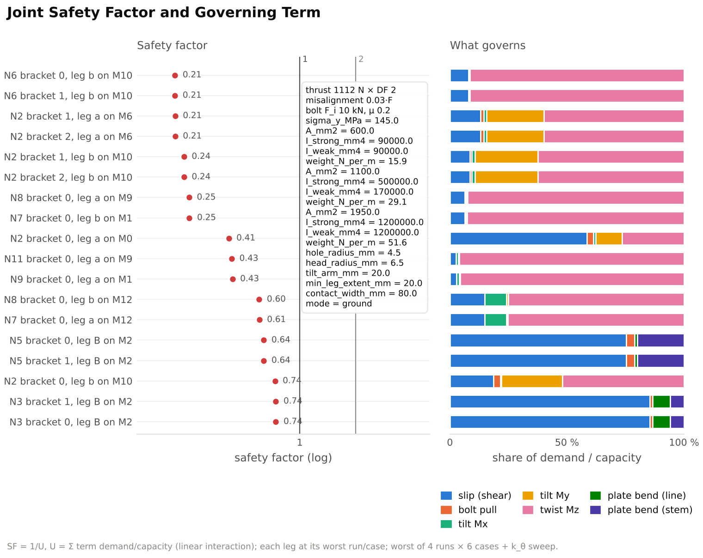

### SF of the critical items in every load case

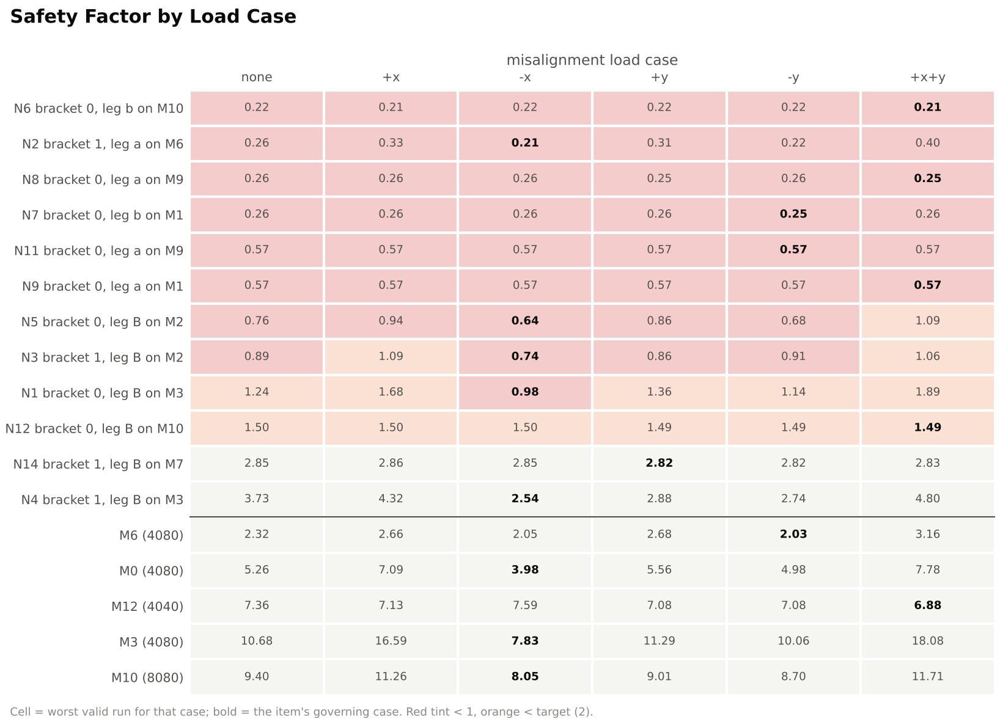

### Thrust-point tilt and deflection by load case

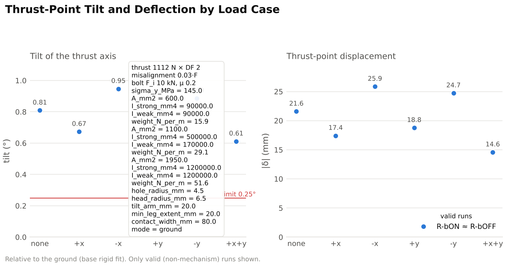

### Member axial force (load path)

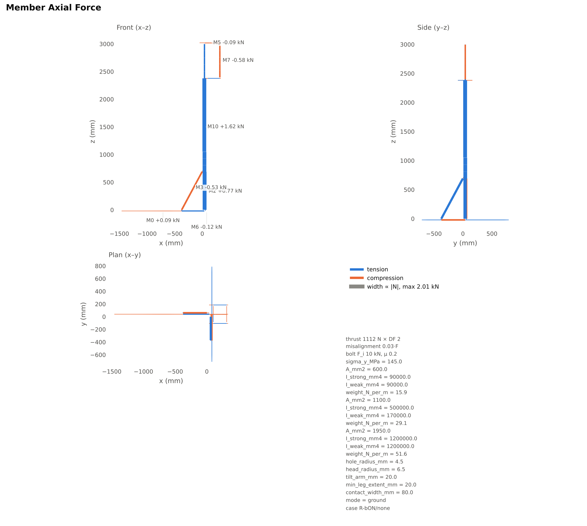

### Peak combined stress

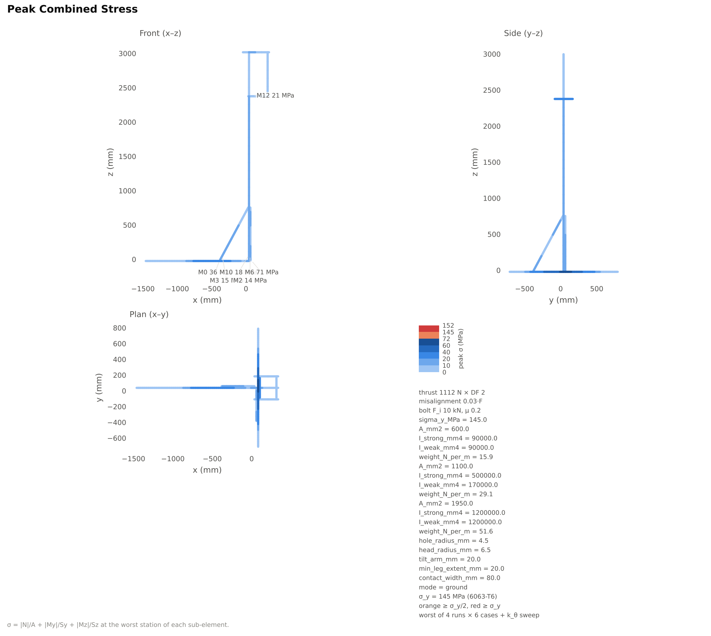

### Deflected shape (worst-tilt case)

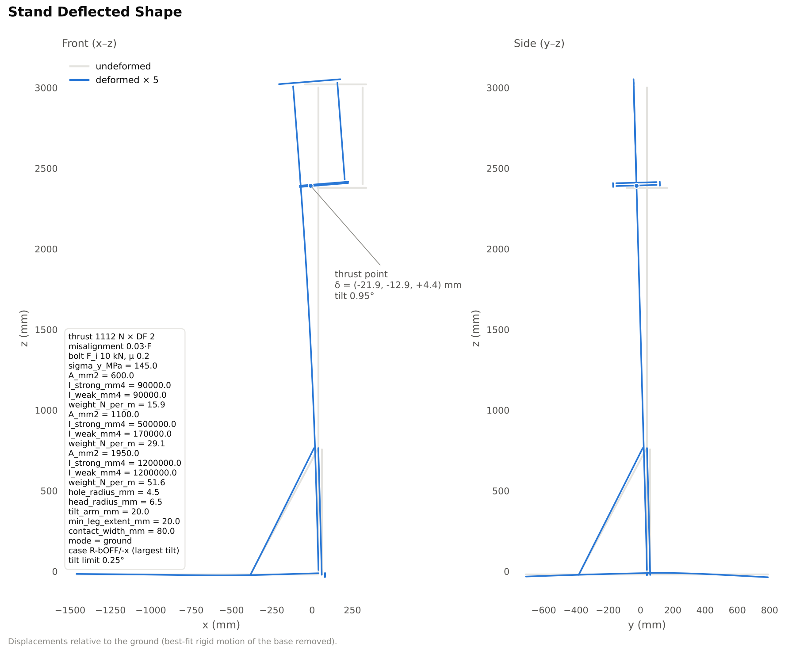

### Frame buckling mode

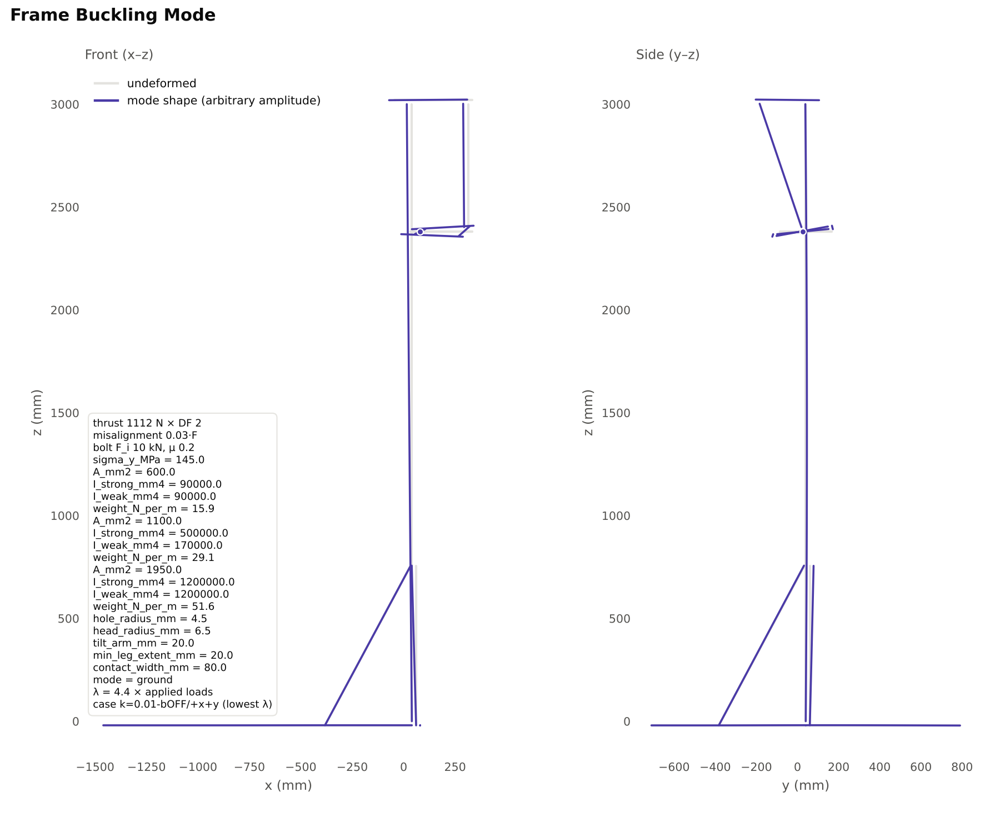

### Ground reaction on the base (governing case)

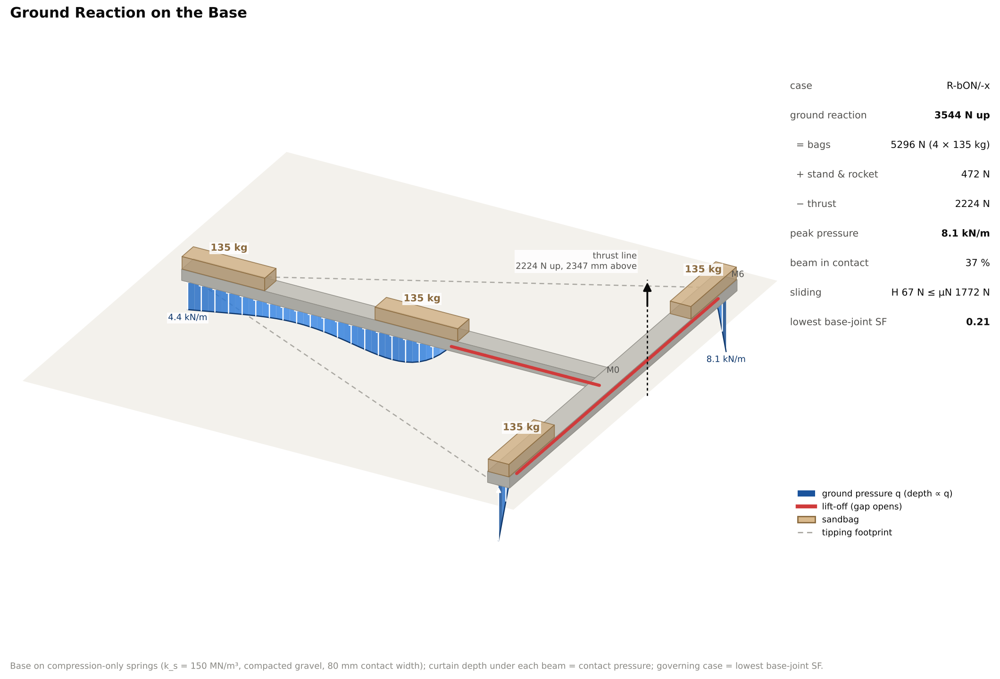

### Ground reaction by load case (plan)

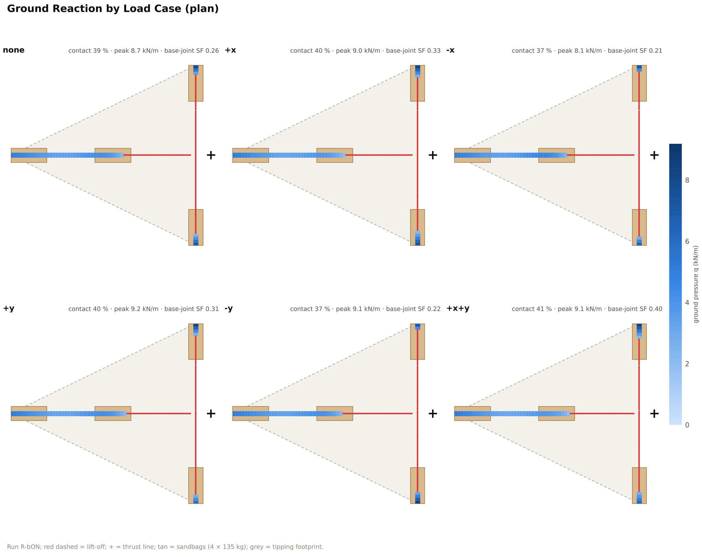

### SF vs joint rotational stiffness

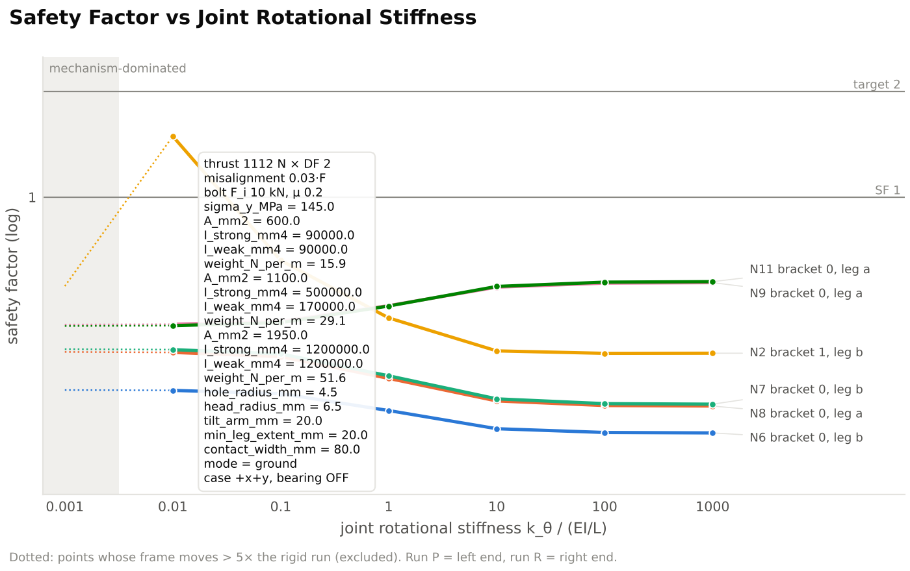

